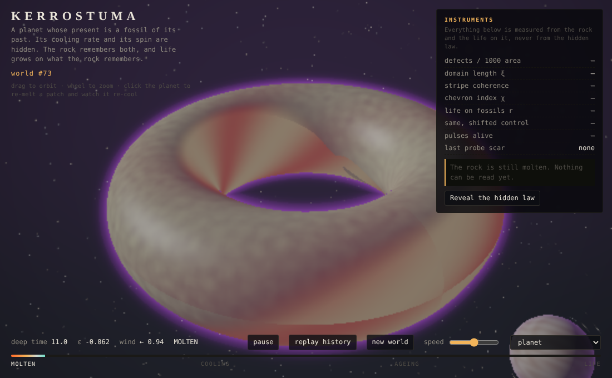
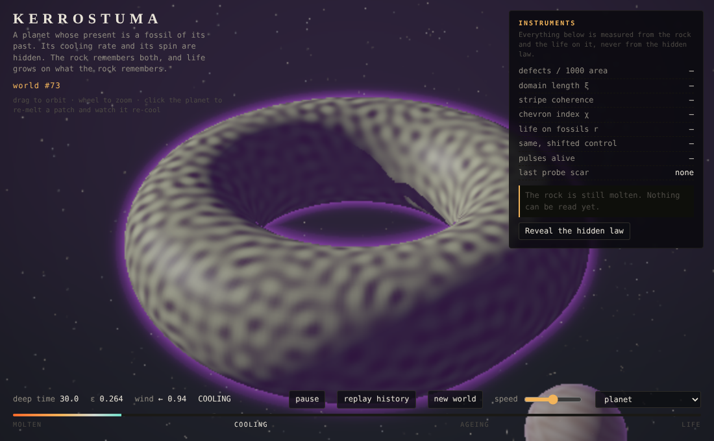
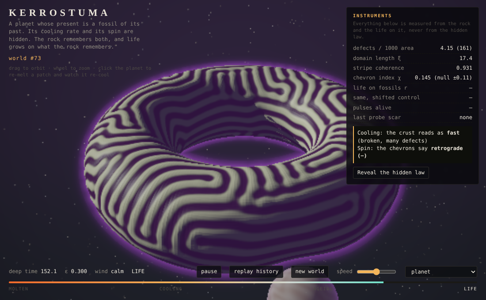
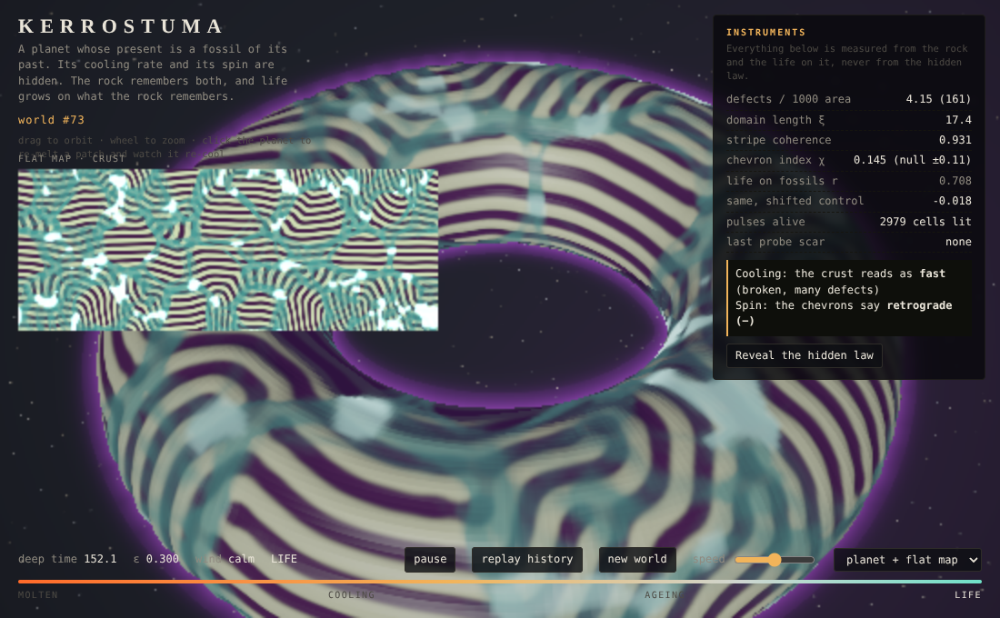

# Kerrostuma

*Finnish for a deposited layer.*

A planet whose present is a fossil of its past.

Each world is drawn from a seed: a hidden cooling rate and a hidden spin. You watch it form from a molten donut. The crust freezes into a fingerprint of stripes, the formation winds comb it, and then it goes still. Carriers hatch at the crust's broken places and lay a vein network between them. Pulses of light run along the veins. The instrument panel then reads the hidden past back off the rock, and **Reveal the hidden law** shows whether the rock told the truth.

One HTML page, WebGL2, no libraries, no build. `core.js` holds the same laws on the CPU so they can be tested.

**Live:** https://anttiluode.github.io/Kerrostuma/  ·  locally: `python3 -m http.server` and open `http://localhost:8000`

| molten | cooling | the present | life |
|---|---|---|---|
|  |  |  |  |

*Frames from the headless end-to-end run (software WebGL at half resolution, world #73). While the crust forms, the colour uses an exposure gain so the faint young pattern is visible; the relief always uses the true field.*

## What you are looking at

| layer | what runs | where it came from |
|---|---|---|
| **Crust** | Swift–Hohenberg on the curved torus, quenched: ∂ψ/∂t = ε(t)ψ − (1+∇²)²ψ − ψ³ − U(v)∂ψ/∂s + noise | CrystalMoon (the Mexican-hat crystal), phi-world `best.py` (the field that makes stable structures) |
| **Cooling** | ε ramps from −0.25 (molten) to +0.30 over the hidden time τ<sub>Q</sub> (30–450) | the Kibble–Zurek idea measured in ArrowField / RajapintaFable: the faster the quench, the more broken the frozen order |
| **Spin** | a zonal wind U = U₀ sin v blows only while the crust forms. Shear tilts the stripes' wavevectors, then the wind stops and the tilt stays as chevron belts | the "history writes structure" thread (Sapolsky-fractal skew, MorphoGenetic order fossils) |
| **Life** | 20 480 carriers sense trail and food, food is eaten and regrows, trail consolidates into gel, gel conducts an excitable medium | GelatinIsland (carriers → gel → excitation), JelloBrain |
| **Light** | the planet is ray-marched; its relief is the crust ψ. A crystal moon bends light toward its mass | AnttisBrain / AnttisBrain2 (lensing moons, one branchless shape) |
| **Probe** | click the planet: a disk is re-melted and re-cools at a known fast rate (τ = 15) | the experimenter thread: interventions read what observation alone cannot |

**Why a torus.** A periodic grid maps onto a torus with no seam and no poles. The field lives on the curved surface: every derivative uses the metric ds² = h(v)²du² + r²dv², with h = R + r cos v. The stripes are therefore the same physical width on the inner and outer equator.

## Does it work? The ledger

*Do not hype. Do not lie. Just show.* All numbers are from `results/receipt.json`, produced by `node experiments/run.js` on the exact demo geometry (352 × 136 torus, R ≈ 50.4, r ≈ 19.5).

**Verified**

- **GPU = CPU.** The WebGL crust matches the `core.js` reference step for step. After 2000 steps the maximum difference is 6 × 10⁻⁸ on a field of size 1.8 × 10⁻⁴ (float32 rounding). Run end to end in headless Chromium, the GPU took world #73 from molten to present and landed on the CPU's numbers: defects 4.15 vs 4.15, χ 0.145 vs 0.145, ξ 17.4 vs 17.4. The page then read it correctly as *fast*, *retrograde* (`results/browser.json`).
- **The crust remembers how fast it cooled.** Defect density over 10 calibration worlds:

  | τ<sub>Q</sub> | 30 | 60 | 120 | 240 | 450 |
  |---|---|---|---|---|---|
  | defects / 1000 area | 4.20, 4.56 | 4.00, 4.64 | 1.96, 1.42 | 1.34, 1.19 | 2.81, 0.80 |

  One threshold (2.52) separates fast cooling (τ<sub>Q</sub> < 85) from slow in 9 of 10 calibration worlds. **On 8 fresh worlds the calibration never saw, the instruments read the cooling class correctly 8/8.**
- **The crust remembers the spin, when it can be read.** With no wind (6 worlds), the chevron index |χ| stays ≤ 0.107: this is the null band. Spin is claimed only above it. It was claimed on 5 of 18 worlds (4 calibration, 1 blind), all of them fast-cooled, and **correct 5/5**.
- **Life grows on the fossils.** Gel against crust frustration (the vents) gives r = 0.66, 0.66, 0.70 on the three blind worlds grown on the CPU, and r = 0.73 grown on the GPU. The same map shifted by half a planet gives r = −0.06 to 0.02.
- **The grown network is a conductor.** An identical pulse into the frozen grown gel lights 4005–6705 cells. The same gel values shuffled in place (same histogram, same protected source) light 176–243. That is 17–38× farther, the GelatinIsland shape test reproduced here.
- Unit checks (`npm test`): the metric Laplacian against the analytic torus Laplacian (< 1 % error), area conservation, molten-decays/crystal-grows, the wind window, the probe, and life not producing NaN.

**Not established / limits**

- **Spin is unreadable on slowly cooled worlds.** Big domains mean few independent samples, so χ stays inside the null band and the page says *unreadable*. On these worlds the fossil exists but is too faint to read. The null band was measured on fast worlds only.
- **Cooling is read as a class, not a number.** Within each class the defect density is too noisy to invert, so no τ<sub>Q</sub> number is claimed. One slow calibration world (τ<sub>Q</sub> = 450, seed 101) came out defect-rich, so a misread is possible.
- **Age is fixed and known (120).** Age and cooling rate are a gauge: both coarsen the crust, so from one snapshot they cannot be told apart. The next step is to make age hidden too and use the re-melt probe, a quench at a known rate on known-age rock, to break that gauge. It is not done here.
- **The re-melt probe heals instead of measuring.** The scar was expected to re-freeze broken, a fast quench at a known rate. It doesn't: the surrounding stripes template the melt from its rim. On world 73 it came back with 0.0 % broken rock inside against 3.0 % around. So the probe is not yet an independent cooling meter. A larger disk, or a probe that also pins the rim, would be needed to break the age–rate gauge with it.
- **No stable-structure → nested-world promotion yet** (the `best.py` / CrystalMoon descent). The moon is an optical object, not a portal.
- The lensing strength and all colours are artistic. The defect counter is a threshold on amplitude dips, not a topological charge count. The life rules are a custom excitable medium in the Physarum tradition (Jones 2010), not biology.
- The planet is a model. Nothing here says real planets form this way.

## Closure: does what the rock tells you close under what the planet does?

The question, from the residue / dimensional-collapse thread: a compact code E of a big state X is only a *state* if, after an interaction q, the new code can be computed from the old code alone:

  E(F(X, q)) = g(E(X), q)

If two crusts share a code but the same query sends them to different next codes, the code threw away something the future needs. This is the lumpability / predictive-state condition, tested here on a physical system. Run it with `node experiments/closure.js` → `results/closure.json`.

**Design.** 36 crusts on the demo torus: τ<sub>Q</sub> ∈ {30, 60, 120, 240} × age ∈ {40, 120, 360} × 3 seeds. Two queries the planet itself offers:
- **wait**: 80 more time units.
- **melt**: re-melt a fixed disk, re-cool, settle.

The codes are E0, the page's census (defects, χ); E1, plus coherence, ξ and rms; E2, plus the local look around the melt site; and oracles that hold the hidden law. The score is leave-one-trajectory-out k-NN R² of each next-code from each code.

| query → next code | E0 census | E1 | E2 local | hidden law | E0 + true age | E0 + true τ<sub>Q</sub> |
|---|---|---|---|---|---|---|
| wait → defects | **0.94** | 0.93 | 0.86 | 0.69 | 0.89 | 0.91 |
| wait → coherence | **0.92** | 0.93 | 0.89 | 0.77 | 0.87 | 0.90 |
| wait → change in defects | **0.75** | 0.68 | 0.23 | 0.71 | 0.54 | 0.44 |
| melt → broken rock in scar | 0.25 | 0.23 | 0.26 | 0.14 | 0.28 | 0.38 |
| melt → scar minus surroundings | −0.14 | −0.37 | −0.11 | −0.40 | −0.05 | −0.13 |

**What it says**
- **Under waiting, the census is a state.** Two numbers read off the rock predict its next reading better than the hidden law that made it (0.94 vs 0.69). The present beats the past as a predictor: seed-to-seed history differences matter, and the rock has already absorbed them.
- **Waiting does not break the age–rate gauge.** Adding the true age or the true cooling rate to the census does not improve the prediction. Young crusts do coarsen faster (mean change in log-defects over the wait: −0.82 at age 40, −0.27 at age 120, −0.11 at age 360), but the census already accounts for that. *This corrects my prediction* that waiting would split matched-code pairs: crusts that read the same evolve the same, whichever past made them. The gauge hides the past, not the future.
- **Melting does not close on any code tested, including the hidden law.** The scar copies its surroundings: broken rock 7.1 % inside vs 6.3 % around on τ<sub>Q</sub> = 30 crusts, and 0 / 0 on slow ones. The scar-minus-surroundings remainder is unpredictable (R² < 0). Its outcome is set by fine structure at the rim and the melt's own noise, below the resolution of every code here. This is the "keep the residue" case: no coarse summary absorbs it.

**Limits.** 36 crusts, one melt site, one wait length. k-NN R² with 2–10 inputs on 36 points is noisy, and E2's drop is likely partly the curse of dimension. The oracle columns show no gain, which is not proof that none exists.

## Controls

drag to orbit · wheel to zoom · click the planet to re-melt a patch · **replay history** · **new world** (the seed is in the URL hash, so `#73` is always the same world) · speed slider · *planet + flat map* shows the whole surface unrolled.

Worth trying: `#73` (fast cooling: broken crust, readable spin), `#59` (slow cooling: long calm stripes), `#7`.

## Run the receipts

```bash
npm test                         # fast unit checks of core.js (~1 min)
node experiments/run.js          # calibration, null band, blind worlds, life (~40 min on 2 cores)
node experiments/run.js summarize
node experiments/closure.js            # closure test (~45 min on 2 cores)
python3 -m http.server 8123 & node tests/browser.cjs   # end-to-end GPU check in headless Chromium (slow: software WebGL)
```

## Files

- `index.html`: the experience. GPU crust, life and renderer. Every simulation shader mirrors a function in `core.js`.
- `core.js`: the laws and the instruments (census, chevron index, defect count, life-on-fossils).
- `calibration.json`: what the page reads the planet against. Generated, not hand-tuned.
- `experiments/run.js` → `results/receipt.json`: the numbers above.
- `experiments/closure.js` → `results/closure.json`: the closure test.
- `tests/`: unit checks, the headless end-to-end run (`browser.cjs`) and a quick renderer (`render.cjs`).
